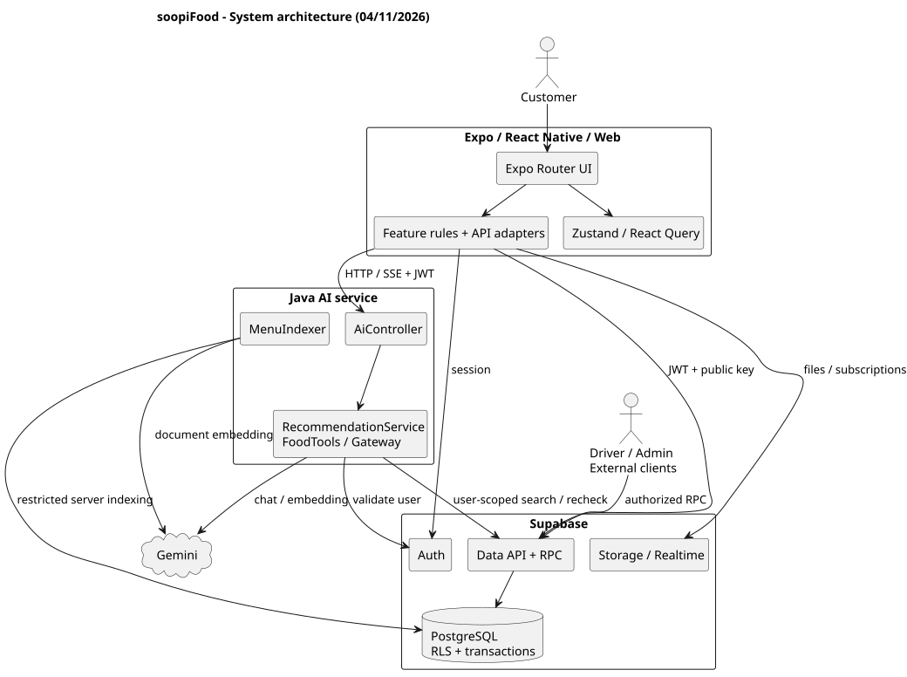
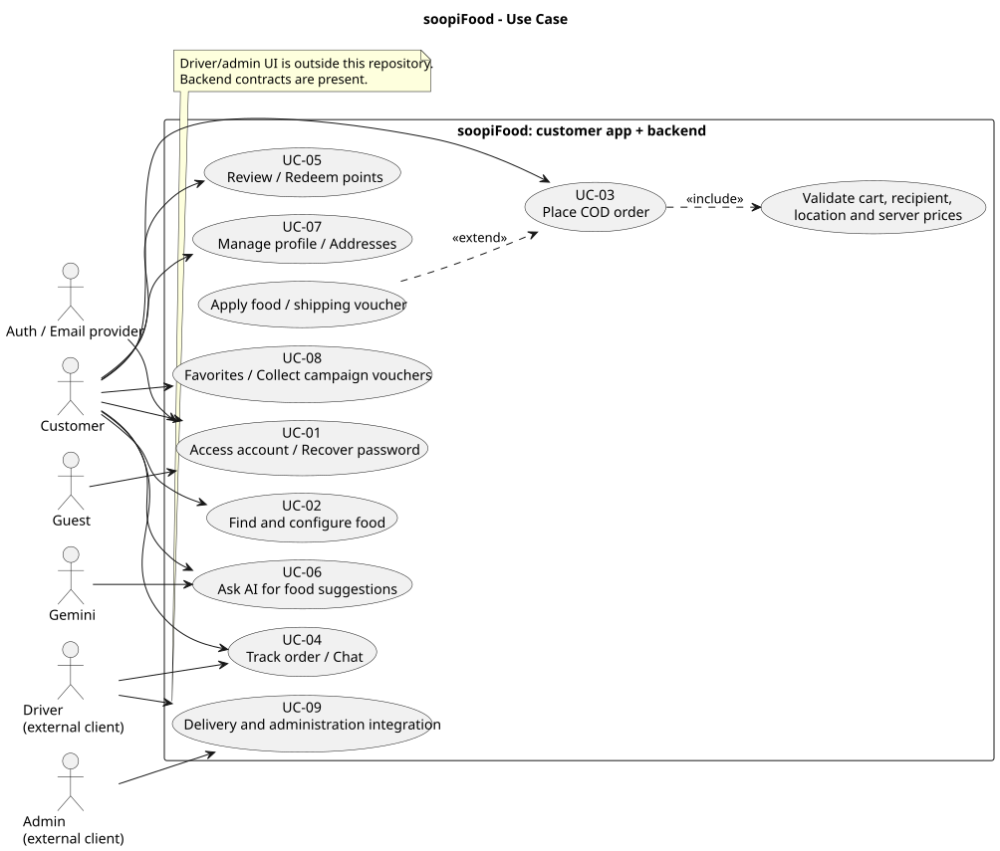
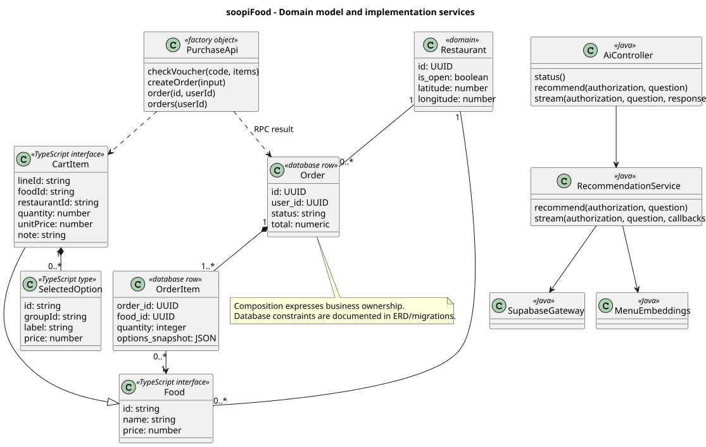
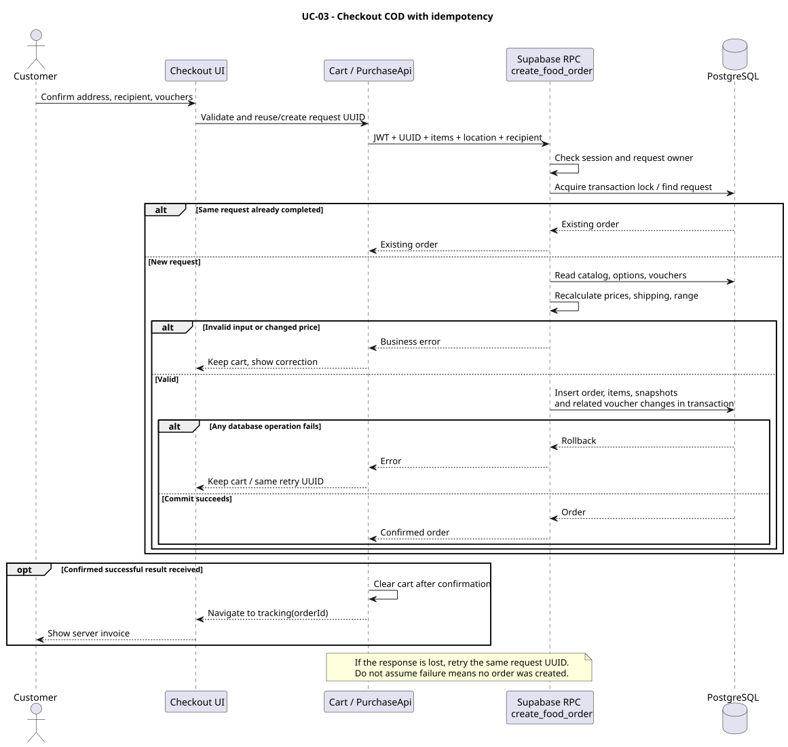
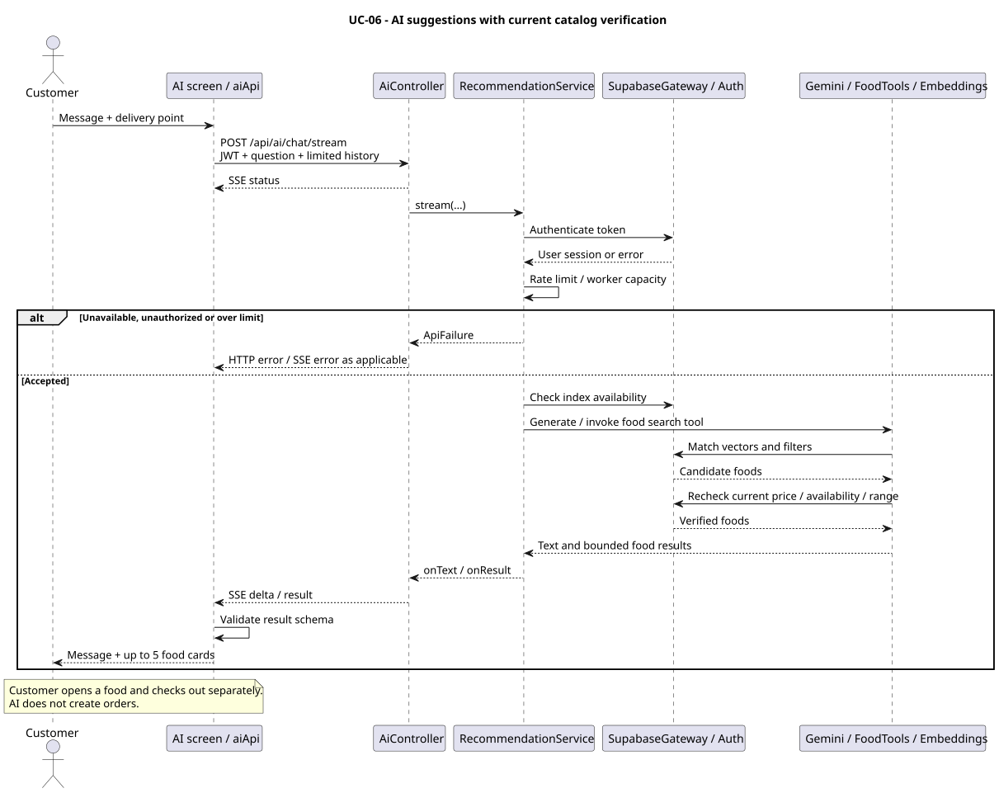
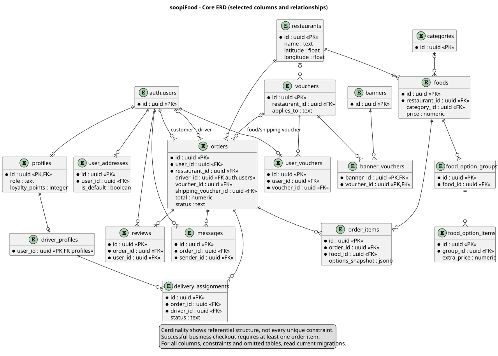

# 2. System Design — SDS

## 2.1. Cơ sở thiết kế

Thiết kế được đối chiếu với code ngày 04/11/2026 và yêu cầu trong [SRS](01-SRS.md). Đây là mô tả kiến trúc đang có; các mục nâng cấp được ghi riêng. Phiên bản khai báo: Expo `~57.0.7`, React `19.2.3`, React Native `0.86.3`, TypeScript `~6.0.3`, Supabase JS `^2.49.1`, Zustand `^5.0.16`, React Query `^5.67.1`. Phiên bản cài cụ thể do `package-lock.json` quyết định. Backend AI khai báo Java 17, Spring Boot 4.0.9, Spring AI 2.0.2 trong `ai-service/pom.xml`.

## 2.2. Kiến trúc tổng thể

- **Presentation:** Expo Router trong `src/app`; giao diện chia theo feature. NativeWind hỗ trợ style, các component dùng chung tách khỏi route.
- **State:** Zustand quản lý phiên/giỏ/vị trí và trạng thái cục bộ; React Query quản lý dữ liệu server, cache và invalidation. Giỏ có persistence theo tài khoản.
- **Application/data access:** `src/services/*Api.ts` nhận client, thực hiện truy vấn/RPC; quy tắc thuần nằm trong `src/features` và `src/utils`. Cách nhận client giúp test bằng fake client.
- **Backend nghiệp vụ:** Supabase Auth, Data API, PostgreSQL function/RPC, policy RLS, Storage và Realtime. Checkout không đi qua một Express backend riêng.
- **Backend AI:** Spring REST controller → RecommendationService → SupabaseGateway/MenuEmbeddings/FoodTools. Gemini chỉ được gọi từ backend. MenuIndexer lập embedding; dữ liệu vector ở schema `private`.
- **Hosting:** `server/serve.js` phục vụ static build/manifest theo công cụ build riêng; không phải API xử lý đơn hàng. `scripts/build.js` khác với lệnh Expo export thông thường.

Lựa chọn BaaS giảm lượng server CRUD cần viết nhưng khiến migration, RLS, RPC và cấu hình Auth là một phần bắt buộc của sản phẩm. Java AI được tách để giữ key server và xử lý giới hạn, streaming, truy xuất vector.

## 2.3. Phân rã module

| Module | Vị trí | Trách nhiệm |
|---|---|---|
| Auth | `src/app/(auth)`, `src/store/authState.ts`, `src/services/passwordRecovery.ts`, `socialAuthFlow.ts` | Phiên, đăng ký, email OTP, OAuth |
| Catalog/Search | `src/features/home`, `search`, `catalog`, `food-detail`; `catalogApi.ts` | Danh sách, nhóm khám phá, quán, tùy chọn và tìm kiếm |
| Cart/Checkout | `src/store/cart*`, `src/features/order/purchase.ts`, `purchaseApi.ts` | Snapshot giỏ, validate, voucher và RPC tạo đơn |
| Location/Recipient | `src/features/location`, `features/order/recipient.ts`, `utils/distance.ts` | Ghim, khoảng cách, phí, người nhận và persistence |
| Orders/Driver | `src/features/order/ServerTracking.tsx`, `deliveryProgress.ts`, `driverApi.ts` | Hóa đơn, tiến độ và vị trí được backend cho phép |
| Engagement | `engagementApi.ts`, `reviewFlowApi.ts`, `restaurantReviewsApi.ts` | Favorites, đánh giá, tổng hợp review |
| Voucher/Rewards | `voucherApi.ts`, `rewardsApi.ts`, `features/offers` | Thu thập, chiến dịch banner, ví và đổi xu |
| Account/Chat | `accountApi.ts`, `chatApi.ts`, `features/chat` | Hồ sơ, địa chỉ, ảnh, tin nhắn và cửa sổ chat |
| AI | `src/services/aiApi.ts`, `src/app/ai-assistant.tsx`, `ai-service/src` | Hợp đồng JSON/SSE, xác thực, truy xuất và phản hồi |

## 2.4. Use Case UML

[Mã PlantUML](diagrams/use-case.puml). Ranh giới là hệ thống soopiFood gồm app khách và backend. Tài xế/quản trị dùng client bên ngoài repo. Quan hệ `include` chỉ dùng cho bước bắt buộc của checkout; áp voucher là `extend`, vì khách có thể đặt không có mã. Xác thực được mô tả như tiền điều kiện với nghiệp vụ cần phiên, không vẽ mọi thao tác đều gọi lại màn đăng nhập.

## 2.5. Class UML

[Mã PlantUML](diagrams/class.puml). `CartItem`/`SelectedOption` là cấu trúc TypeScript, không phải bảng database. Order/OrderItem/Restaurant là mô hình miền ánh xạ dữ liệu. `PurchaseApi` là đối tượng trả về từ factory, không khẳng định tồn tại một ES class cùng tên. Các lớp Java AI là lớp triển khai thực tế. Phân biệt mô hình miền và cấu trúc triển khai giúp tránh ép toàn bộ React function thành class.

## 2.6. Sequence UML

### Đặt đơn COD

[Mã PlantUML](diagrams/sequence-checkout.puml). Client gửi UUID ổn định, danh sách món/tùy chọn, địa chỉ, tọa độ, người nhận, phí dự kiến và hai mã voucher. RPC kiểm tra phiên, cùng quán, khả dụng, tùy chọn, giá, tọa độ/phạm vi, voucher và tổng. Phí client là giá trị cần kiểm tra, không phải giá trị server mặc nhiên tin tưởng. Transaction bảo đảm order/items và thay đổi liên quan cùng thành công hoặc rollback. Chỉ khi nhận xác nhận thành công app mới dọn giỏ.

### Gợi ý món AI

[Mã PlantUML](diagrams/sequence-ai.puml). Backend xác thực trước nghiệp vụ, giới hạn tần suất, nhận lịch sử hội thoại có giới hạn, truy xuất và kiểm tra lại dữ liệu hiện hành. Các event SSE gồm `status`, `delta`, `result`, `error`. Client chỉ chấp nhận kết quả phù hợp schema; lỗi hoặc hủy stream không được coi là kết quả thành công.

## 2.7. ERD và từ điển dữ liệu

[Mã PlantUML](diagrams/erd.puml). ERD trình bày phần dữ liệu chính phục vụ đặt món và tích hợp giao hàng, không liệt kê toàn bộ cột hoặc mọi bảng kỹ thuật. Các FK thực tế đến `auth.users` được giữ riêng, không thay bằng FK tưởng tượng đến `profiles`. `orders.driver_id` và `delivery_assignments.driver_id` có đích liên kết khác nhau: Auth user và driver profile.

| Nhóm | Bảng | Dữ liệu/ràng buộc cần hiểu |
|---|---|---|
| Danh tính | `auth.users`, `profiles` | UUID danh tính; profile nối Auth; role và loyalty_points do server kiểm soát |
| Địa chỉ | `user_addresses` | Chủ sở hữu, địa chỉ, ghim, người nhận và mặc định; hóa đơn giữ snapshot riêng |
| Catalog | `restaurants`, `categories`, `foods` | Food thuộc quán; category có thể null; giá và trạng thái hiện hành |
| Tùy chọn | `food_option_groups`, `food_option_items` | Nhóm bắt buộc/chọn nhiều và extra_price |
| Khám phá | `discovery_categories`, `food_discovery_categories` | Nhóm khám phá độc lập category menu; liên kết nhiều–nhiều |
| Chiến dịch | `banners`, `banner_vouchers` | Banner gắn nhiều voucher, có thứ tự; bảng liên kết được thêm trong migration 04/11 |
| Đơn | `orders`, `order_items` | user_id, restaurant_id, driver_id, status, các khoản tiền, người nhận, tọa độ; item có snapshot JSON |
| Khuyến mãi | `vouchers`, `user_vouchers`, `loyalty_redemptions` | Phạm vi food/shipping, hạn, ví của user, giao dịch đổi xu và mã riêng |
| Đánh giá | `reviews`, `food_reviews` | Đơn/user, các giai đoạn đánh giá, phản hồi món; rating quán được đồng bộ |
| Tương tác | `favorites`, `messages` | Favorite gắn user/quán; message gắn đơn/người gửi |
| Tài xế | `driver_profiles`, `driver_presence`, `driver_locations`, `driver_settings` | Duyệt hồ sơ, online, tọa độ và tham số vận hành |
| Giao hàng | `delivery_assignments`, `delivery_events`, `driver_ledger_entries` | Chuyến được giao, sự kiện, tiền/COD; không đồng nhất assignment với order |
| AI | `private.ai_food_embeddings` | Vector, model/content hash phục vụ tìm kiếm; không phải kho dữ liệu người dùng |
| Chưa đủ bằng chứng UI hoàn chỉnh | `calls`, `notifications` | Có bảng không đồng nghĩa đã có gọi điện/push production |

Các trường tiền: `subtotal`, `delivery_fee`, `food_discount_amount`, `shipping_discount_amount`, `total` dùng giá trị VND. `options_snapshot` lưu lựa chọn lúc đặt; dữ liệu đơn cũ có thể có trường null cần UI xử lý. UUID được dùng xuyên client/API/database.

**Nguồn schema:** `src/types/database.types.ts`, `src/types/supabase.ts`, baseline `20261030185128_remote_schema.sql` và các migration tiếp theo. File `20261104084017_remote_schema.sql` chủ yếu cập nhật function; không được xem mọi file tên remote_schema là một bản schema độc lập đầy đủ. `migrations_old` là lịch sử lưu trữ, không tự chạy nối tiếp baseline mới.

## 2.8. Thiết kế API

### API nghiệp vụ qua Supabase

Data API dùng `/rest/v1/<table>` và RPC dùng `/rest/v1/rpc/<function>`, thông qua SDK trong app. Public key định danh ứng dụng, Bearer token định danh phiên; quyền dữ liệu được backend kiểm tra.

| API/RPC | Đầu vào chính | Đầu ra và kiểm soát |
|---|---|---|
| Auth SDK | email/password, OTP recovery, OAuth callback | Session/user hoặc lỗi Auth |
| `create_food_order` | `p_order_id`, `p_items`, `p_address`, `p_latitude`, `p_longitude`, `p_delivery_fee`, `p_recipient_name`, `p_recipient_phone`, `p_voucher_code`, `p_shipping_voucher_code` | Một order; RPC có overload nên client phải dùng đúng tập tham số |
| `update_my_profile` | Các trường hồ sơ cho phép | Profile của caller; không cho đổi role |
| `save_my_address`, `delete_my_address` | ID và nội dung địa chỉ theo service | Địa chỉ/mặc định được cập nhật theo quyền |
| `collect_my_voucher` | `p_voucher_id` | Kết quả ví mã của caller |
| `redeem_loyalty_voucher` | Theo `rewardsApi.ts` | Kết quả đổi xu và voucher riêng; chống replay |
| `submit_order_review` | order, stage, rating, feedback và votes | Kết quả giai đoạn review |
| `restaurant_review_summary/feed`, `food_review_stats` | Quán/món, bộ lọc, phân trang theo API | Dữ liệu tổng hợp và danh sách đánh giá |
| `order_delivery_progress`, `order_driver_location` | `p_order_id` | Tiến độ/vị trí theo quyền khách |
| `driver_step`, `driver_update_location`, `driver_send_message` | Theo hợp đồng tài xế | Xác minh user/chuyến/trạng thái; không gọi từ UI khách để giả lập tài xế |

Ví dụ checkout minh họa: `p_items` là mảng `{foodId, quantity, basePrice, unitPrice, note, options}`. Định dạng thực tế nằm trong `serializeCart`; không gửi tổng cuối làm căn cứ duy nhất. `purchaseApi.ts` ánh xạ lỗi `PGRST202` thành thông báo backend chưa có đúng RPC.

### API AI Java

| HTTP | Đường dẫn | Hợp đồng |
|---|---|---|
| GET | `/api/ai/status` | `{configured: boolean}`; chỉ phản ánh cấu hình, không chứng minh Gemini đang phục vụ |
| POST | `/api/ai/recommendations` | Bearer + Question → `{message, foods}` |
| POST | `/api/ai/chat/stream` | Bearer + Question → `text/event-stream`; stream có event lỗi riêng |

Question gồm `message`, `latitude`, `longitude`, `maxPrice` tùy chọn và `history` tối đa 12 phần tử `{role, content}`. Câu hỏi tối đa 600 ký tự; tọa độ nằm trong miền hợp lệ; `maxPrice` 0…10.000.000 theo Bean Validation. Mỗi food gồm ID món/quán, tên, mô tả, giá, ảnh, tên quán, khoảng cách, gợi ý tùy chọn; schema client giới hạn 5 món và 20 km.

Lỗi REST có `code`, `message`; validation trả 400, lỗi ứng dụng dùng status trong ApiFailure, lỗi ngoài dự kiến trả 503. Với SSE, lỗi sau khi bắt đầu stream phải được đọc qua event thay vì chỉ dựa vào HTTP status.

## 2.9. Toàn vẹn, truy cập và đồng bộ

Client validate để phản hồi nhanh; server kiểm tra lại trước ghi. RLS bảo vệ hàng dữ liệu; function có quyền cao phải tự kiểm tra caller, không dựa vào việc UI giấu nút. Avatar/chat dùng cơ chế Storage phù hợp quyền và URL ký khi cần. Chỉ public key xuất hiện ở Expo; Gemini/service-role key nằm ở backend.

Realtime giúp cập nhật đơn/chat, nhưng lần tải chính vẫn phải truy vấn dữ liệu server; cần xử lý hủy subscription khi rời màn/đổi tài khoản. Không dùng cache của user trước làm dữ liệu cho user sau. GPS tài xế là dữ liệu nhạy cảm và phải lấy qua hợp đồng theo đơn.

## 2.10. Hạn chế thiết kế và hướng mở rộng

Rate limit AI hiện giữ trong một instance; chạy nhiều instance cần kho dùng chung. Khoảng cách Haversine không phải tuyến đường thực tế. Catalog lớn cần rà soát phân trang/index. Các bản schema, types và test fixture đang có nguy cơ lệch phiên bản; 15 SQL script bị lỗi đường dẫn là bằng chứng cần chuẩn hóa. Các vấn đề này được quản lý trong [Maintenance](06-MAINTENANCE.md), không tự thay kiến trúc trong đợt viết tài liệu.
